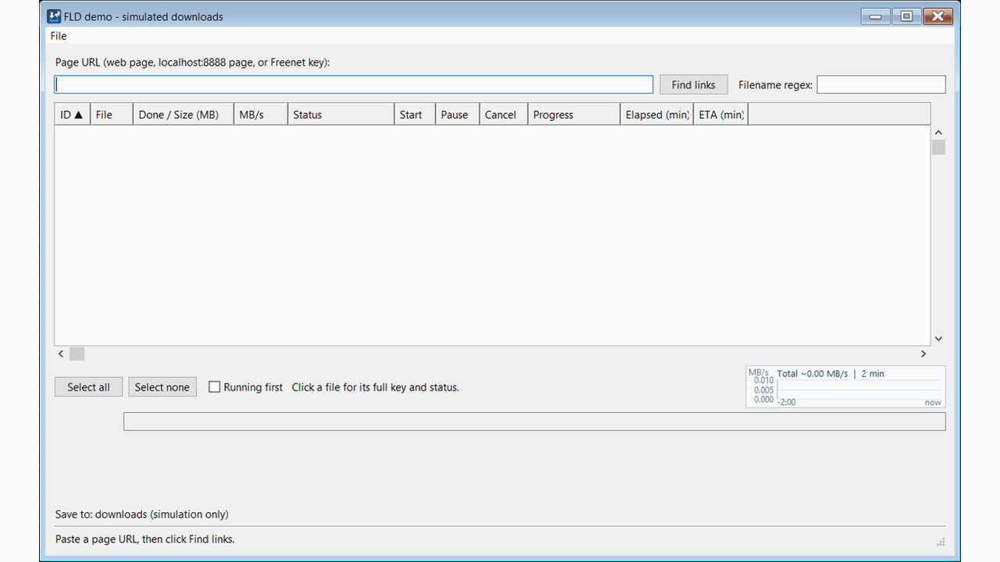

# Freenet Link Downloader

FLD finds Freenet links on a page and manages downloads through your local Freenet node.

## Start

For the standalone app, download [FLD.exe (v0.1.2)](https://github.com/HerManNav/FLD/releases/download/v0.1.2/FLD.exe), place it in a writable folder, and double-click it. Access to this private GitHub repository is required. Python is not required.

For a source checkout, double-click **Start FLD.bat**, or run `python app.py` from this folder. Python with Tkinter is required; FLD has no pip dependencies.

Keep Freenet running with FCP enabled at `127.0.0.1:9481`; its local web interface uses `http://localhost:8888`.

## Download files

1. Paste an HTTP/HTTPS page URL, a Freenet page URL, or a Freenet key. Click **Find links**.
2. Highlight rows with a click; use Ctrl-click to toggle rows or Shift-click to extend a range. **Select all**, **Select none**, and Ctrl+A apply to visible rows while filtering.
3. Click **Download selected** to start highlighted visible files, or use a row's **Start**, **Pause**, and **Cancel** buttons. Column sorting is saved across restarts.
4. Use **Delete selected** or right-click a row and choose **Delete selected** to remove highlighted rows after confirmation. **Remove completed** clears completed history across the queue; downloaded files stay on disk. **Remove unstarted** keeps its separate queue-wide meaning.
5. Use the filename regex field to filter the list, such as `\.jpg$`. Click sortable column headers to change order. **Running first** stays on across sorts and groups active tasks by progress. Turn it off and sort **ID** ascending (▲) to restore scrape order.
6. Click **Open download folder** to see saved files.

Files go in `downloads` beside `app.py` for source runs, or beside `FLD.exe` for standalone runs. The queue database is stored in the same folder. Move the executable beside an existing queue to reuse it; FLD does not copy or migrate queues. Use a writable folder. Existing files are not overwritten; duplicate names get a number suffix.

**Pause** keeps partial data so the same download can resume. **Cancel** discards that node request and its partial data. **Remove unstarted** removes only files that have never been started; running, paused, cancelled, failed, and completed tasks stay in the queue.

## Window and recovery

Resize the window or drag a header divider. Double-click a divider to fit its column. Window size, maximize state, and column widths are restored next time.

Clicking **X** hides FLD in the notification area. Restore it from the tray menu. Use **File > Exit** or the tray menu's **Exit** to close the app. Freenet may continue submitted downloads while FLD is closed.

The queue and pause states are saved in `queue.sqlite3` beside the app. After a PC restart, start Freenet and FLD to reconnect. Keep Freenet's persistent storage and the queue database to resume downloads.

For development and architecture notes, see [docs/development.md](docs/development.md) and the [feature map](docs/README.md).
